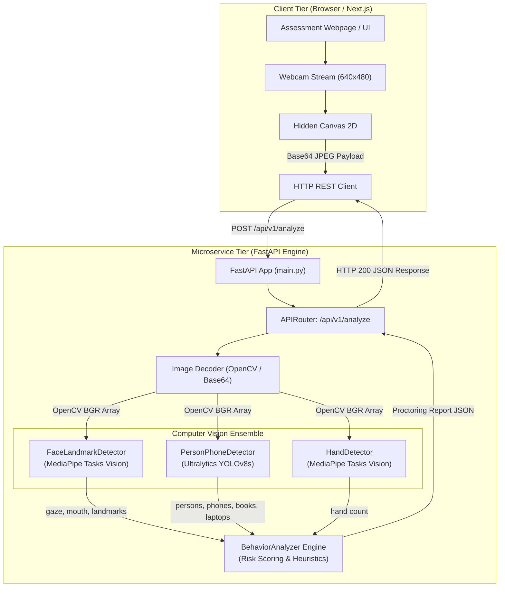

# 01 - System Architecture

## 1. High-Level Architecture Overview
The system is built as a **Stateless Computer Vision Microservice** following a client-server paradigm. The frontend captures webcam frames, transforms them into base64 payload strings, and submits them over HTTP/REST to a FastAPI service. The service coordinates an ensemble of computer vision detectors, aggregates infractions via a rule-based behavioral engine, and returns a JSON diagnosis.



## 2. Detailed Component Breakdown

### A. API Routing & Ingestion Tier
* **Entrypoint**: [`main.py`](file:///c:/Users/soura/Desktop/hackshift/main.py)
  * Configures FastAPI application with wildcard CORS (`allow_origins=["*"]`).
  * Mounts `/api/v1` routes from `api.routes.py`.
  * Mounts static endpoints: `/` (health check) and `/test` (interactive proctoring UI).
* **Controller**: [`api/routes.py`](file:///c:/Users/soura/Desktop/hackshift/api/routes.py)
  * Instantiates detectors as module-level singletons to prevent model reloading overhead per request.
  * Accepts `FrameData` Pydantic model (`{"image": "<base64>"}`).
  * Decodes base64 string to OpenCV BGR matrix via `decode_base64_image()`.

### B. Machine Learning Ensemble Tier
1. **FaceLandmarkDetector ([`detection/face_landmark_detector.py`](file:///c:/Users/soura/Desktop/hackshift/detection/face_landmark_detector.py))**:
   - Model file: `models/face_landmarker.task`
   - Extracts 478 3D facial landmarks and 52 facial blendshapes.
   - Computes:
     - Gaze yaw orientation: Left / Right via `eyeLookOutLeft`, `eyeLookOutRight`, `eyeLookInLeft`, `eyeLookInRight`.
     - Head pitch score: Up / Down via `eyeLookDown` and `eyeLookUp` delta.
     - Mouth movement / Talking: Delta threshold on `jawOpen`.
2. **PersonPhoneDetector ([`detection/person_phone_detector.py`](file:///c:/Users/soura/Desktop/hackshift/detection/person_phone_detector.py))**:
   - Model file: `yolov8s.pt`
   - Restricts search space to target COCO classes:
     - Class `0`: Person (counts attendees, flags proxy candidates)
     - Class `67`: Cell Phone (flags handheld devices)
     - Class `63`: Laptop (flags secondary monitors)
     - Class `73`: Book (flags reference cheat-sheets)
3. **HandDetector ([`detection/hand_detector.py`](file:///c:/Users/soura/Desktop/hackshift/detection/hand_detector.py))**:
   - Model file: `models/hand_landmarker.task`
   - Configured for up to 4 simultaneous hands (`num_hands=4`).
   - Flags suspicious assistance when $\ge 3$ hands are identified.

### C. Behavioral Scoring Tier
* **Engine**: [`services/behavior_analyzer.py`](file:///c:/Users/soura/Desktop/hackshift/services/behavior_analyzer.py)
* Receives raw feature maps from all three detectors.
* Computes deterministic penalties:
  $$\text{Score} = \min(100, \sum \text{Penalties})$$
* Returns formatted audit report with human-readable malpractice strings.

## 3. Communication Sequence Diagram

```mermaid
sequenceDiagram
    autonumber
    actor Candidate
    participant Browser as Browser Client (Webcam)
    participant FastAPI as FastAPI Server (/api/v1/analyze)
    participant Decoder as Image Decoder (OpenCV)
    participant Vision as AI Ensemble (YOLO + MediaPipe)
    participant Analyzer as BehaviorAnalyzer

    Candidate->>Browser: Opens Exam Page & Grants Camera
    loop Every 1.5 - 2.0 seconds
        Browser->>Browser: Draw frame to hidden Canvas
        Browser->>Browser: Convert Canvas to data:image/jpeg;base64
        Browser->>FastAPI: POST /api/v1/analyze {"image": base64}
        FastAPI->>Decoder: decode_base64_image(image)
        Decoder-->>FastAPI: frame (np.ndarray BGR)
        
        par Parallel / Sequential Inference
            FastAPI->>Vision: FaceLandmarkDetector.detect(frame)
            FastAPI->>Vision: PersonPhoneDetector.detect(frame)
            FastAPI->>Vision: HandDetector.detect(frame)
        end
        Vision-->>FastAPI: Detections (gaze, objects, hands)
        
        FastAPI->>Analyzer: analyze(face_res, person_res, hand_res)
        Analyzer-->>FastAPI: report (suspicion_score, malpractices)
        FastAPI-->>Browser: HTTP 200 JSON Response
        Browser->>Browser: Update UI gauges & warning banners
    end
```
