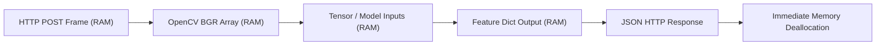

# 06 - Data & Database Architecture

## 1. Database Presence Analysis
* **Database Management System**: **None (Stateless Architecture)**.
* **Persistent Storage**: None in this repository.
* **ORM / ODM**: No ORM (SQLAlchemy, Prisma, Mongoose, etc.) is included or required.

---

## 2. Rationale for Stateless Design

The AI Proctoring Service was architected as an **independent computation microservice** rather than a monolithic full-stack app.

### Advantages of Statelessness in this Context:
1. **Linear Horizontal Scalability**: Instances can scale out behind an AWS Application Load Balancer or Google Cloud Run without requiring database connection pool management or shared memory states.
2. **Strict Privacy Compliance (GDPR, FERPA)**:
   - No student webcam photos, frames, or biometric recordings are stored on disk or written to a database.
   - Once a frame is processed through the inference pipeline, its NumPy array in RAM is immediately marked for garbage collection.
3. **Decoupling from Assessment Engines**: The microservice can be plugged into any assessment backend (PostgreSQL, MongoDB, Supabase, Firebase) without imposing a database schema on the host application.

---

## 3. Data Lifecycle in Memory



1. **Ingestion**: Base64 string deserialized in RAM into a NumPy byte buffer.
2. **Inference**: MediaPipe and YOLO operate on temporary memory arrays.
3. **Response**: Diagnostic dictionary transformed to JSON string and sent to client.
4. **Deallocation**: Python garbage collector frees the image matrix buffer.

---

## 4. Recommended Schema for Host Applications (Integration Pattern)

Host applications (e.g., Next.js with PostgreSQL or MongoDB) that need to persist incident logs for review should store records using the following recommended schema:

```sql
CREATE TABLE proctoring_incidents (
    id UUID PRIMARY KEY DEFAULT gen_random_uuid(),
    session_id UUID NOT NULL REFERENCES exam_sessions(id),
    candidate_id UUID NOT NULL REFERENCES users(id),
    timestamp TIMESTAMP WITH TIME ZONE DEFAULT NOW(),
    suspicion_score INT CHECK (suspicion_score BETWEEN 0 AND 100),
    face_present BOOLEAN NOT NULL,
    person_count INT NOT NULL,
    gaze_direction VARCHAR(16) NOT NULL,
    is_talking BOOLEAN NOT NULL,
    phone_detected BOOLEAN NOT NULL,
    book_detected BOOLEAN NOT NULL,
    laptop_detected BOOLEAN NOT NULL,
    hands_count INT NOT NULL,
    malpractices TEXT[] -- Array of active violation descriptions
);

CREATE INDEX idx_proctoring_session ON proctoring_incidents(session_id);
CREATE INDEX idx_proctoring_suspicion ON proctoring_incidents(suspicion_score) WHERE suspicion_score >= 60;
```
