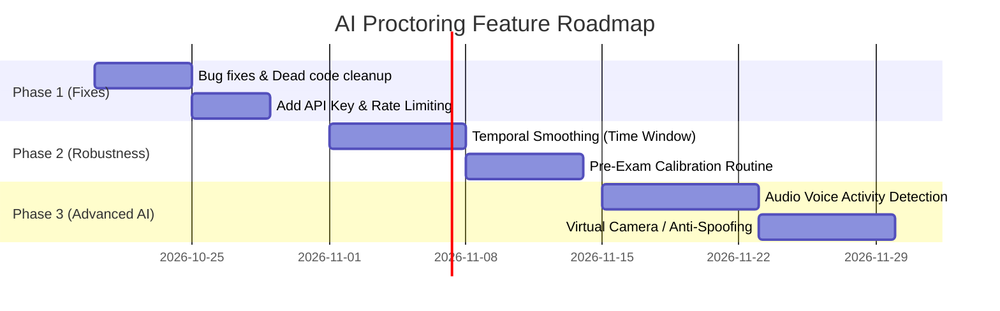

# 12 - Known Issues, Bugs & Development Roadmap

This document outlines active bugs, technical debt, and prioritized next steps for future development.

---

### 1. Active Bugs & Code Vulnerabilities

#### Bug 1: `pitch_score` Scope Vulnerability in `face_landmark_detector.py`
* **File**: [`detection/face_landmark_detector.py:L83`](file:///c:/Users/soura/Desktop/hackshift/detection/face_landmark_detector.py#L83)
* **Description**: `pitch_score` is only assigned inside `if results.face_blendshapes:`. If `results.face_landmarks` has landmarks but blendshapes fail to compute, the return statement attempts to evaluate `pitch_score`, throwing `UnboundLocalError`.
* **Fix**: Initialize `pitch_score = 0.0` at line 35 alongside `face_present = False`.

#### Bug 2: Client-side Polling Accumulation in `test_frontend.html`
* **File**: [`test_frontend.html:L340`](file:///c:/Users/soura/Desktop/hackshift/test_frontend.html#L340)
* **Description**: Uses `setInterval(process, 1500)`. If network latency or CPU inference takes longer than 1500ms, requests pile up in a backlog.
* **Fix**: Replace `setInterval` with a recursive `setTimeout` or add an `isProcessing` lock:
  ```javascript
  if (isProcessing) return;
  isProcessing = true;
  try { await process(); } finally { isProcessing = false; }
  ```

#### Bug 3: Missing `'use client'` in Next.js Components
* **Files**: [`ProctoringPanel.jsx`](file:///c:/Users/soura/Desktop/hackshift/ProctoringPanel.jsx), [`frontend_integration_example.js`](file:///c:/Users/soura/Desktop/hackshift/frontend_integration_example.js)
* **Description**: React hooks (`useState`, `useEffect`, `useRef`) fail in Next.js App Router without `'use client';` at the top of the file.
* **Fix**: Add `'use client';` as the very first line of both files.

#### Bug 4: Camera Mirror Inversion in UI
* **File**: [`test_frontend.html:L54`](file:///c:/Users/soura/Desktop/hackshift/test_frontend.html#L54)
* **Description**: CSS `scaleX(-1)` mirrors the preview for the user, but the raw canvas captures an un-mirrored frame. When a student glances right, the detector outputs "Left", confusing users.
* **Fix**: Flip canvas context horizontally before drawing (`context.translate(640, 0); context.scale(-1, 1);`) or invert gaze labels in UI.

---

### 2. Technical Debt & Cleanup Items

1. **Delete Dead Legacy Files**:
   - `detection/face_detector.py` (Old stub file returning static dictionary).
   - `detection/gaze_detector.py` (Old stub file returning static dictionary).
2. **Remove Unused Large Weights**:
   - `yolov8n.pt` (6.2 MB) and `yolov8m.pt` (49.7 MB) are unused (the code uses `yolov8s.pt`). Deleting them saves ~56 MB in git history and container builds.
3. **Consolidate Integration Guides**:
   - `FINAL_INTEGRATION_STEPS.md` and `NEXTJS_INTEGRATION.md` contain overlapping instructions; merge into a single canonical integration document.

---

### 3. Prioritized Development Roadmap



#### Phase 1: Stability & Security Hardening
* Fix `pitch_score` initialization bug.
* Add API Key authentication and `slowapi` rate limiting (1 req/sec).
* Constrain Pydantic image string size to 500 KB to avoid memory abuse.

#### Phase 2: Behavioral Accuracy & Temporal Smoothing
* Implement a **3-second sliding window buffer** per session ID.
* Replace single-frame alerts with cumulative time alerts (e.g., alert on mouth movement only if sustained for $\ge 3$ consecutive seconds).
* Add a 15-second pre-exam calibration step to personalize gaze thresholds.

#### Phase 3: Audio-Visual Multimodal Proctoring
* Add client-side microphone capture.
* Integrate Web Audio API or backend Voice Activity Detection (VAD) to correlate mouth movement with actual speech frequencies (300 Hz–3400 Hz), eliminating yawning false positives.

#### Phase 4: Virtual Camera Anti-Spoofing
* Query `navigator.mediaDevices.enumerateDevices()` to block virtual video drivers (OBS, ManyCam).
* Add challenge-response blink/head-turn verification at start of test.
